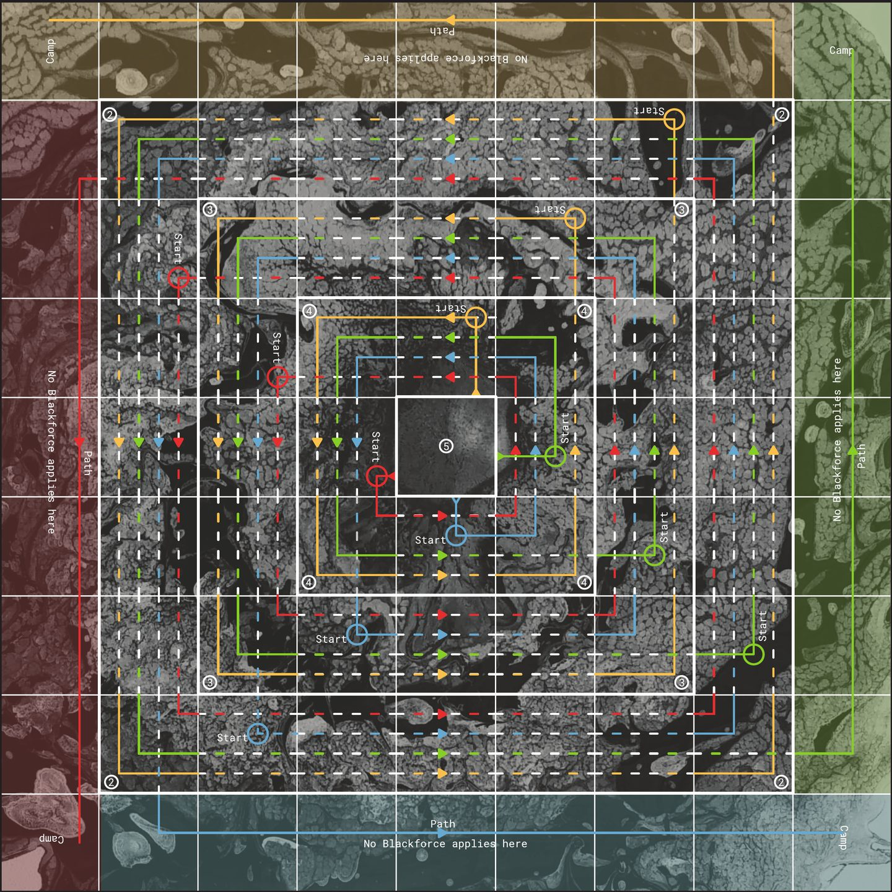

# Blackpool: Escape the Dark Waters

## [▶ Play Blackpool in your browser](https://prayasabhinav.github.io/games/blackpool/play/)

On one screen or each on your own phone, and any colour nobody takes can play itself. No sign-in.

A race for two to four players out of a whirlpool. Priyamvada Gaur and I made it in 2019, at Nonserious, the games brand of my company Storyflock Education and Design Services. Each player has three travellers. A die, called the Oracle, gives you your Whiteforce for the turn, the number you compare with each ring's pull, and each ring of the whirlpool pulls back with its own Blackforce. A traveller that lands on another player's rides on it instead of knocking it off.

The game's page: https://prayasabhinav.github.io/games/blackpool/

## Files

| File | What it is |
|---|---|
| [`print/blackpool-board-front.pdf`](print/blackpool-board-front.pdf) | The board, 360 mm square, with the piggy-back tables along its edge |
| [`print/blackpool-board-backside.pdf`](print/blackpool-board-backside.pdf) | The back of the board |
| [`print/blackpool-booklet.pdf`](print/blackpool-booklet.pdf) | The rules booklet, 36 pages |
| [`blackpool-booklet-text.md`](blackpool-booklet-text.md) | The booklet as text, page by page |
| [`print/blackpool-charm-cards.pdf`](print/blackpool-charm-cards.pdf) | The five charm cards, faces and backs |
| [`print/blackpool-curse-cards.pdf`](print/blackpool-curse-cards.pdf) | The five curse cards, faces and backs |
| [`print/blackpool-play-pieces.pdf`](print/blackpool-play-pieces.pdf) | The twelve travellers, three in each colour |
| [`print/blackpool-coins.pdf`](print/blackpool-coins.pdf) | The coins, three in each colour, a charm face and a curse face |
| [`blackpool-licence-cc-by-4.0.txt`](blackpool-licence-cc-by-4.0.txt) | Its licence, Creative Commons Attribution 4.0 |

You also need a six-sided die.

## Rules

The full rules are in the booklet. The play page has a short version under *How to play*. Where the booklet leaves something open, *How this version reads the rules* on the play page says what the page does.

The booklet's glossary gives the rings a Blackforce of 4 down to 1, and says a 5 brings a traveller out of the centre. The board and the rest of the booklet say 4, 3 and 2, and a 6, and the page follows them.

## Licence

© 2019 Prayas Abhinav and Priyamvada Gaur, under Creative Commons Attribution 4.0. The 2019 print files carry the copyright line of Storyflock Education and Design Services LLP, which first published the game.
