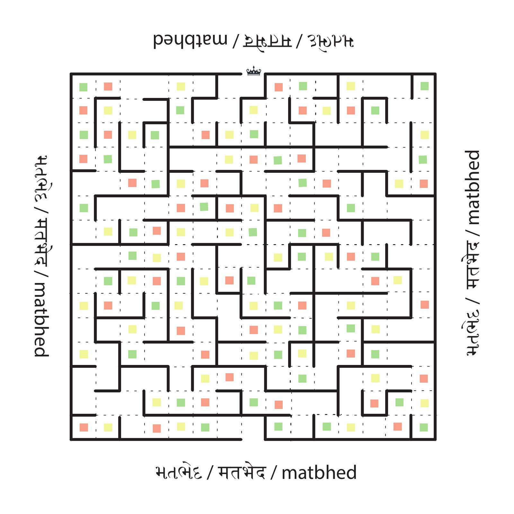

# Matbhed | મતભેદ | मतभेद

A board game about Article 25 of the Constitution of India, the freedom of religion. Jaskaran Singh and I designed it in 2023 for Conflictorium's Re-Art25 project in Ahmedabad. Players move through a maze, and each coloured box they land on gives them a card describing a situation to respond to: a temple, a marriage, a law, a court case. A Judge scores every answer.



The game's page: https://prayasabhinav.github.io/games/matbhed/

## Files

| File | What it is |
|---|---|
| [`matbhed-board.pdf`](matbhed-board.pdf) | The board, 18 × 18 inches, as printed on canvas in March 2023 |
| [`cards/matbhed-cards-english.pdf`](cards/matbhed-cards-english.pdf) | All 53 cards in English, one to a page, 2.5 × 3.5 inches: 20 red, 20 yellow, 13 green |
| [`cards/matbhed-cards-gujarati.pdf`](cards/matbhed-cards-gujarati.pdf) | The same 53 cards in Gujarati |
| [`cards/matbhed-objection-tokens.pdf`](cards/matbhed-objection-tokens.pdf) | Objection tokens, on A4, to print and cut out |
| [`cards/matbhed-cards-english.txt`](cards/matbhed-cards-english.txt) | The English card texts, to read or change |
| [`cards/matbhed-cards-gujarati.txt`](cards/matbhed-cards-gujarati.txt) | The Gujarati card texts |
| [`cards/matbhed-cards.typ`](cards/matbhed-cards.typ) | Builds the card PDFs from the text files |
| [`cards/matbhed-cards-corrections.md`](cards/matbhed-cards-corrections.md) | What has been corrected in the card texts since the 2023 print |

You also need a six-sided die and a counter for each player.

## Rules

**Players:** 2 to 16. **Points to exit:** 25 by default. **Age:** 15 and over.

The board is a maze. You win by sharing what you know and by discussion: find the exit and escape with a set number of points, anywhere from 25 to 100.

**Moving.** Each player rolls the die to move. When you land on a coloured box, take a card of the matching colour, read it out and give your response. You can move in any direction, but you cannot change direction during a turn unless a wall is in front of you.

**Points.** A Judge scores each answer from 1 to 7. The Judge can be one person or a group, and all the players can act as the Judge together. Every answer earns at least 1 point; you earn more by convincing the Judge with your legal thoroughness and awareness. The more cards you answer, the more points you can gain.

**Objections.** Each player starts with three objection tokens. Any player can object to another player's response, and with a valid objection or a better answer can take that player's points. If the objection is not valid, or the new answer is not suitable, the objector loses points. The Judge decides whether an objection is valid.

**Winning.** The game ends when every player has left the maze. The player who gains the points needed to exit, and then reaches the exit, wins.

## Making changes

The card texts are plain text files: one card to a paragraph, and a line such as `# red` before each colour. Change a text and rebuild the PDF with [Typst](https://typst.app):

```
typst compile --input lang=english cards/matbhed-cards.typ cards/matbhed-cards-english.pdf
typst compile --input lang=gujarati cards/matbhed-cards.typ cards/matbhed-cards-gujarati.pdf
```

A new language needs a `cards/matbhed-cards-<language>.txt` beside the others. The 2023 cards were set in Ideal Sans, Kohinoor Gujarati and Minion Pro; where those are not installed, the build falls back to the free Noto fonts.

## Licence

Creative Commons Attribution 4.0 International, as in the 2023 rule booklet. Credit Prayas Abhinav and Jaskaran Singh.
